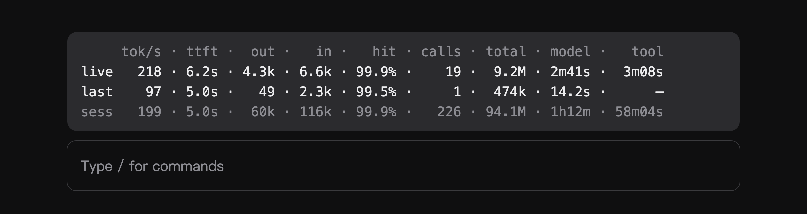

# ccstatus-band

**English** · [中文](README.zh-CN.md)

A small table above the prompt of the Claude Code desktop app. Three rows: the prompt you are in, the one before it, and the session. Eight columns you can switch on and off.



```
     tok/s · ttft ·  out ·   in ·   hit · calls · total · model ·   tool
live   218 · 6.2s · 4.3k · 6.6k · 99.9% ·    19 ·  9.2M · 2m41s ·  3m08s
last    97 · 5.0s ·   49 · 2.3k · 99.5% ·     1 ·  474k · 14.2s ·      —
sess   199 · 5.0s ·  60k · 116k · 99.9% ·   226 · 94.1M · 1h12m · 58m04s
```

Every field keeps its column, so you read one column down instead of hunting. Values are right-aligned on the widest in their column, and no row appears or disappears. The rows use the surface's monospaced face with tabular digits; in a proportional face, padded spaces line nothing up.

## What each row means

| Row | Meaning |
| --- | --- |
| `live` | **This prompt.** It moves while the reply streams; a column the API has not reported yet shows `—`. After it ends the row keeps its final numbers until your next prompt. |
| `last` | **The prompt before it**, frozen when it ended. `—` throughout until a second prompt has finished. |
| `sess` | **Everything in the session so far**, the running prompt included, so it grows while `live` does. |

| Column | Meaning |
| --- | --- |
| `tok/s` | Decode rate: output tokens over the time spent generating them. Tool runs and prefill are left out. While a reply streams it is **estimated** from the characters received (see below). |
| `ttft` | Wait before the row's first generated chunk: prefill plus whatever the gateway spent queueing it. `sess` shows the mean over its prompts; a wait too short for the clock to separate reads `—`. |
| `out` | Generated tokens. |
| `in` | Prompt tokens that were **not** served from the prompt cache. |
| `hit` | Share of the prompt tokens that came from the cache. |
| `turn` | Which prompt of the session this was, counting from 1. Off by default. |
| `calls` | Model calls the prompt made that returned usage: one prompt is usually several calls (answer → tool → answer), and a call that never got its usage (an interrupt) counts as none. |
| `total` | Everything carried: uncached input + cache reads + cache writes + output. |
| `model` | Wall time the row spent waiting on the model: request to stop chunk, so prefill, gateway queueing and generation. |
| `tool` | Wall time the row spent on tool runs: the gaps between one call's stop and the next call's request. |

`total` counts what the API was asked to read, not what is new: one 138k conversation sent five times in a prompt adds up to 690k. That is the cost, not the context length.

A running prompt's own counts (`in`, `hit`, `total`) stay `—` until its first call stops: the API reports them at a call's stop and nowhere earlier. The other columns move as the reply streams, and the end of the prompt settles the row on the API's numbers.

`live`'s `tok/s` and `out` are the only estimates. The API reports a response's token counts once, in its last chunk, so mid-stream there is nothing to count; the band counts CJK characters as one token and everything else as a quarter, then replaces the estimate with the API's own numbers when the response ends. It is good enough to watch, not to reconcile against a bill.

## Columns

Each column is its own switch under **Settings › Plugins › ccstatus-band** (the rows `/config` lists as `ccstatus-band.col_*`). `turn` is off by default; turn it on to see prompt numbers beside `calls`. With every column off the band draws nothing.

## Where the numbers come from

Beyond the estimates on the live row, everything is the API's own accounting, read from the engine's `turn.step` and `turn.complete` events:

- **Per call, not per prompt.** A prompt is usually several calls (answer → tool → answer). Some gateways report only the last call's usage at `turn.complete`; the band sums every call's `stop` chunk instead, so a row is the whole prompt.
- **Subagents are excluded.** Their steps run their own loop; folding their tokens into the session rate would make it meaningless.
- **Uncounted prompts are skipped.** A gateway that answers a prompt with an all-zero usage object leaves the band showing the previous numbers rather than `0 tok/s`.

## Install

The app loads any folder under `~/.claude/skills/` that has a `.claude-plugin/plugin.json` and a `hooks/hooks.json`:

```bash
git clone https://github.com/gzhang33/ccstatus-band.git ~/.claude/skills/ccstatus-band
```

Restart the session (or start a new one) and the band appears above the prompt. To remove it, delete the folder.

Or install it from this repository's marketplace:

```
/plugin marketplace add gzhang33/ccstatus-band
/plugin install ccstatus-band --marketplace gzhang33/ccstatus-band
```

Requires a Claude Code build that supports mods (`turn.step` / `turn.complete` / the `AbovePrompt` render target) — 2.1.x and later of the desktop app.

## Develop

```bash
claude plugin validate .      # manifest + hooks module, the way the engine reads them
claude plugin test .          # the tests in tests/, against the real hook engine
```

The layout:

- `hooks/register.tsx` — the whole mod: rate accounting, the per-call sum, the three rows, the table
- `types/index.d.ts` — the shape of what it keeps in `$.state`
- `tests/band.test.tsx` — the three rows, a running prompt's dashes, uncounted prompts, ttft, column switches

## Limitations

- A field wider than its column (a `10.5M` total against a `5.0M` session) pushes that column one character right for the rest of the session.
- Before the session's first prompt the band draws nothing, and `last` stays `—` until a second prompt has finished.
- Nothing changes during prefill or while a gateway queues the call: the stream has no chunk to count then, so the live row keeps its last state until the first token arrives.
- `model` and `tool` are wall time, not billed time: a gateway that queues the call for 30s counts 30s. The session's `model` starts when the mod loads, so a session resumed from disk shows time it did not cause.
- No cost figure: it needs a price table per model, and this one is used behind several gateways.

## License

MIT — see [LICENSE](LICENSE).
