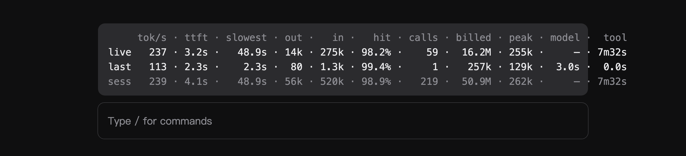

# ccstatus-band

[English](README.md) · **中文**

Claude Code 桌面版输入框上方的一张表：三行分别是本次 prompt、上一条 prompt 和整个会话，八列各自可以开关。



```
     tok/s · ttft · slowest · out ·    in ·   hit · calls · billed · model ·  tool
live   237 · 3.2s ·   48.9s · 14k · 16.2M · 98.2% ·    59 ·  16.2M ·     — · 7m32s
last   113 · 2.3s ·    2.3s ·  80 ·  257k · 99.4% ·     1 ·   257k ·  3.0s ·  0.0s
sess   239 · 4.1s ·   48.9s · 56k · 50.9M · 98.9% ·   219 ·  50.9M ·     — · 7m32s
```

同一个指标永远在同一列，竖着扫一列即可。值按该列最宽的一项右对齐，行不会忽隐忽现。全表使用等宽字体与等宽数字；比例字体下，靠空格凑出的列宽对不齐任何东西。

## 三行分别是什么

| 行 | 含义 |
| --- | --- |
| `live` | **这一次 prompt**。回复进行中它随之变化；API 还没报的列显示 `—`。结束后定格为终值，直到你发下一条。 |
| `last` | **再上一次 prompt**，在它结束时定格。会话只有一条 prompt 时整行都是 `—`。 |
| `sess` | **本会话到目前为止的全部**，包含正在进行的这条，所以它与 `live` 一起增长。 |

| 列 | 含义 |
| --- | --- |
| `tok/s` | 端到端吞吐：输出 token ÷ 各次调用在模型上花的时间，**含预填充与排队**。窗口不足 1 秒显示 `0`，避免短回复产生无意义的巨大比值。回复进行中该值为**估算**（见下）。工具执行仍不计。 |
| `ttft` | **每次模型调用**的首个生成 chunk 之前的平均等待：预填充 + 网关排队。分母是真正测到到的调用次数，不是全部调用数。 |
| `slowest` | 这些等待里最慢的一次。某次调用卡在网关队列会把它拉得远高于 `ttft`，而均值会把它藏起来；两者相等说明该行只有一次调用。 |
| `out` | 模型输出的 token。 |
| `in` | 提示 token，按网关的口径显示：默认 `openai` 口径下它是整段提示（含缓存读），因此 `in + out = billed`；切到 `anthropic` 则只显示未命中缓存的部分。 |
| `hit` | 提示 token 的缓存命中率：`缓存读 ÷ (未缓存输入 + 缓存读 + 缓存写)`，按该行的各次调用汇总。向下取整到一位小数，所以 `100.0%` 表示每个提示 token 都是缓存读，99.96% 显示为 `99.9%`。 |
| `turn` | 这是本会话的第几条 prompt（从 1 起）。默认关闭。 |
| `calls` | 这条 prompt 中**拿到 usage 的模型调用次数**：一条 prompt 通常包含多次调用（回答 → 调工具 → 再回答）；被中断、没拿到 usage 的调用不计。 |
| `billed` | 各次调用的提示与输出之和：未缓存输入 + 缓存读 + 缓存写 + 输出。这是吞吐量，不是新增内容——255k 的上下文调 59 次就计 16M。 |
| `model` | 该行等待模型的墙钟时间：从发出请求到 stop chunk，含预填充、网关排队与生成。 |
| `tool` | 该行工具执行的墙钟时间：上一次调用结束到下一次调用发出之间的间隔。 |

`billed` 算的是"发出去让模型读了多少"，不是"新增了多少"：一段 138k 的对话在一条 prompt 里发送五次，就计 690k。这是成本口径，不是上下文长度。要看这条 prompt **新增**了多少，用 `billed − 缓存读`，或把 `usage format` 切到 `anthropic`，此时 `in` 就是未缓存的那部分。

进行中的 prompt 自己的计数（`in`、`hit`、`billed`）在首次调用结束前保持 `—`，因为 API 只在调用结束时才有这些数；其余各列随回复实时变化，`turn.complete` 时以 API 的真实数字定稿。

只有 `live` 的 `tok/s` 与 `out` 是估算。API 只在一条回复的最后一个 chunk 里报一次 token 数，流式过程中没有可计数的东西；条带把中文/日文/韩文字符按 1 个 token、其他字符按 0.25 个 token 折算，回复结束时立刻换成 API 的真实数字。它适合看"现在快不快"，不适合拿去对账。

## 用量口径

网关对 `input_tokens` 的定义不一致：OpenAI 兼容网关报的是整段提示（缓存读含在其中），Anthropic 只报未命中缓存的那部分。**usage format** 设置用来选择：

- `openai`（默认）—— `in` 是整段提示，`in + out = billed`。
- `anthropic` —— `in` 只是未缓存部分；`billed` 仍等于 `in + 缓存读 + 输出`。

两种口径下缓存命中率相同：`缓存读 ÷ 整段提示`。

## 列的显示

每一列都可以单独开关：**设置 › 插件 › ccstatus-band**（即 `/config` 里的 `ccstatus-band.col_*`）。`turn` 默认关闭，打开即可在 `calls` 旁边看到 prompt 序号。所有列都关掉时条带不绘制。

## 数字从哪来

除 `live` 行的估算值外，全部是 API 自己的账，来自引擎的 `turn.step` 与 `turn.complete` 事件：

- **按调用累加，不按 prompt。** 一条 prompt 通常包含多次调用（回答 → 调工具 → 再回答）。部分网关只在 `turn.complete` 报最后一次调用的用量，本 mod 改为在每次调用的 `stop` chunk 处累加，所以一行是全条 prompt 的真值。
- **命中率天然偏高，是算术决定的。** 长对话每次调用都要重发，其中绝大部分是缓存读：本会话自己的调用就在 98–99.9%，因为只有本轮新增的那几条消息、一条工具结果或上一次回答是未缓存的。会改写前缀的路由（DeepSeek 官方文档把 96% 当作预期值）会把命中率压低；条带报的是网关返回的数，不是原厂的基准值。
- **不计子代理。** 子代理跑自己的循环，把它的 token 混进会话速度会让这个数失去意义。
- **prompt 自己的回包优先于它的各次调用。** 有些网关在每次调用的 stop chunk 上报全 0，只在 prompt 结束时给出真实总量。因为一条 prompt 就是一个问题，它的总量可信：条带会用 prompt 的数字补上调用没报的项，所以这类会话仍有数值、`last` 也照常填充。只有整条 prompt 什么都没报时才跳过。

## 安装

桌面版会加载 `~/.claude/skills/` 下任何带 `.claude-plugin/plugin.json` 和 `hooks/hooks.json` 的目录：

```bash
git clone https://github.com/gzhang33/ccstatus-band.git ~/.claude/skills/ccstatus-band
```

重启会话（或新开会话）后条带即出现在输入框上方。删除该目录即可卸载。

也可以直接从本仓库的市场安装：

```
/plugin marketplace add gzhang33/ccstatus-band
/plugin install ccstatus-band --marketplace gzhang33/ccstatus-band
```

需要支持 mod 的 Claude Code 版本（`turn.step` / `turn.complete` 事件与 `AbovePrompt` 渲染目标），桌面版 2.1.x 起。

## 开发

```bash
claude plugin validate .      # 按引擎的方式校验清单与 hooks 模块
claude plugin test .          # 跑 tests/ 下的测试，跑的是真实 hook 引擎
```

结构：

- `hooks/register.tsx` —— 整个 mod：速率计算、按调用累加、三行语义、表格渲染
- `types/index.d.ts` —— 存在 `$.state` 里的数据形状
- `tests/band.test.tsx` —— 三行语义、进行中 prompt 的 `—`、全零 prompt、ttft、列开关

## 已知限制

- 某项数值宽于列宽时（`5.0M` 的会话里出现 `10.5M` 的合计），该列会在本次会话余下时间右移一个字符。
- 会话第一条 prompt 之前条带不绘制；`last` 行要等第二条 prompt 结束才有值。
- 预填充与网关排队期间条带不会变化：流里还没有可计数的 chunk，live 行保持上一个状态，首个 token 到达即刷新。
- `ttft` 在引擎的钩子处计时，不在套接字处：起点是请求到达本机这一侧，终点是首个 chunk，所以含排队与预填充，但不等于模型自己认为的开始读入时刻。
- `model` 与 `tool` 是墙钟时间，不是计费时间：网关排队 30 秒就计 30 秒。会话行的 `model` 从 mod 加载时起算，从磁盘恢复的旧会话会显示它并未造成的时长。
- 不显示费用：需要每个模型的价目表，而这个 mod 常在多个网关后面使用。

## 许可

MIT，见 [LICENSE](LICENSE)。
